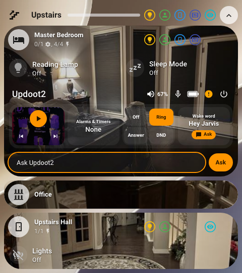

# Helpmeet: Area Card

[](https://github.com/Helpmeeters/area-card)
[](https://github.com/Helpmeeters/area-card/releases)
[](LICENSE)

A [Home Assistant Marketplace](https://www.home-assistant.io/integrations/marketplace/) / [HACS](https://hacs.xyz/) Lovelace plugin for Home Assistant areas and floors — **Area Card** shows an Area, **Floor Card** shows all Areas in a Floor, and **Floors Card** shows all Areas, organized by Floor.

<p align="center">
  
</p>

## Zero-Config Philosophy

Each card requires only the selection of an Area or Floor (or nothing at all for **Floors Card**). Area Card depends heavily on Area hygiene, so your dashboard stays as well-organized as your Home Assistant. All customization happens directly in your dashboard.

## Features

- **Automatic Area Discovery** — Pick an area and the card reads its name, icon, picture, and assigned entities, building a `#area-<area_id>` popup organized by domain.
- **Status Dots & Tooltips** — Fixed-slot section dots (`lights`, `media`, `cameras`, `switches`, `occupancy`, `openings`, `satellites`, `sensors`, `locks`, `vacuums`) with hover tooltips listing every row in that section.
- **Subtitles & Unavailable Dimming** — Compact subtitle with temperature and humidity readings, helper counts, and automation summaries (including disabled automation counts), plus half-opacity dimming when all device entities in an area are unavailable.
- **Pinning & Live Camera Backgrounds** — Pin favorite entities under the area button (**Always** or **While on** with a 2-minute grace window), or use a camera's live stream as the card background, synced per Home Assistant user across browsers.
- **Battery Overlay** — Toggleable per-area battery percentage badges (**Off**, **Green**, **Yellow**, **Red**) synced per user across browsers.
- **Floor & Floors Cards** — Collapsible **Floor Card** that aligns all areas on a floor and hides unused dot columns floor-wide, plus **Floors Card** to render every floor in registry order.

## Views

<table>
  <tr>
    <td align="center" width="50%">
      <strong>Area Card</strong><br />
      
    </td>
    <td align="center" width="50%">
      <strong>Area Popup</strong><br />
      
    </td>
  </tr>
</table>

## Installation

### Marketplace / HACS (Recommended)

[](https://my.home-assistant.io/redirect/hacs_repository/?owner=Helpmeeters&repository=area-card&category=plugin)

*(This link opens **Marketplace** on Home Assistant 2026.11+ and **HACS** on earlier versions.)*

#### Home Assistant Marketplace (2026.11+)

1. Go to **Settings → Marketplace**.
2. In the upper-right corner, select **Add from link**.
3. Enter `https://github.com/Helpmeeters/area-card` and select **Add** (if prompted for type, choose **Dashboard**).
4. Open **Helpmeet: Area Card** in the list and select **Install**.

#### HACS (2026.10 and earlier)

1. Open **HACS** in Home Assistant.
2. Click the three-dot menu in the top right and select **Custom repositories**.
3. Enter `https://github.com/Helpmeeters/area-card` and select **Dashboard** (or **Lovelace**) as the category.
4. Click **Add**, then search for **Helpmeet: Area Card** and click **Download**.
5. Refresh your browser when prompted.

### Manual Installation

1. Download `area-card.js`, `area-card-bubble.js`, and `area-card-mushroom.js` from the [latest release](https://github.com/Helpmeeters/area-card/releases/latest) (all three files must sit in the same directory).
2. Copy them to `/config/www/`.
3. In Home Assistant, go to **Settings → Dashboards → Resources**, click **Add Resource**, and enter:
   - **URL**: `/local/area-card.js`
   - **Resource type**: `JavaScript Module`

## Configuration

### Area Card (`custom:area-card`)

Add **Area Card** from the Home Assistant dashboard card picker and select an **Area**.

```yaml
type: custom:area-card
area: office_of_drew
```

| Option | Type | Required | Description |
| --- | --- | --- | --- |
| `type` | `string` | **Yes** | `custom:area-card` |
| `area` | `string` | **Yes** | Area ID from Home Assistant. |

### Floor Card (`custom:floor-card`)

Displays a collapsible floor header with aggregated status dots and one **Area Card** per area on that floor, sorted alphabetically and aligned by dot column. Add **Floor Card** from the card picker and select a **Floor**.

```yaml
type: custom:floor-card
floor: downstairs
```

| Option | Type | Required | Description |
| --- | --- | --- | --- |
| `type` | `string` | **Yes** | `custom:floor-card` |
| `floor` | `string` | **Yes** | Floor ID from Home Assistant. |

### Floors Card (`custom:floors-card`)

Renders one **Floor Card** for every floor in Home Assistant, in the floor registry's order. The visual editor has no fields.

```yaml
type: custom:floors-card
```

| Option | Type | Required | Description |
| --- | --- | --- | --- |
| `type` | `string` | **Yes** | `custom:floors-card` |

## Advanced Configuration

### Hiding Sections (`area-card`)

Hide specific sections from both the collapsed card and the popup using **Hide sections** in the visual editor or `hide_sections` in YAML:

```yaml
type: custom:area-card
area: office_of_drew
hide_sections:
  - media
  - satellites
```

Valid `hide_sections` IDs: `climate`, `lights`, `media`, `cameras`, `switches`, `occupancy`, `openings`, `satellites`, `sensors`, `locks`, `vacuums`, `buttons`, `scenes`, `scripts`, `helpers`, `automations`.

### Demo Mode (`area-card`)

Enable **Demo** in the visual editor or set `demo: true` in YAML to preview the card using the built-in Demo Room without reading live Home Assistant entities (`area` can be omitted):

```yaml
type: custom:area-card
demo: true
```

| Option | Type | Required | Description |
| --- | --- | --- | --- |
| `hide_sections` | `list` | No | Section IDs to hide from both the collapsed card and the popup. |
| `demo` | `boolean` | No | Fill the card from the built-in Demo Room instead of live Home Assistant entities. |

## Bundled Dependencies

This card runs private, prefixed copies of:

- [Bubble Card](https://github.com/Clooos/Bubble-Card) v3.4.3 (MIT)
- [Mushroom](https://github.com/piitaya/lovelace-mushroom) v5.2.3 (Apache-2.0)

They are loaded from `vendor/` next to `area-card.js` (or from the same directory when installed via Marketplace / HACS) with prefixed custom element names (`area-card-bubble`, `area-card-mushroom-*`), so separate installs of Bubble Card or Mushroom never conflict and the card picker stays clean. License texts are in `LICENSES/`.

## Technical Reference

For section ordering, dot slot rules, entity classification, subtitle formatting, pinning, battery thresholds, camera backgrounds, and demo room details, see the [Technical Reference](docs/technical-reference.md).

## Contributing

Bug reports and pull requests are welcome. See [CONTRIBUTING.md](CONTRIBUTING.md) for the development setup and what to include in a bug report, and [SECURITY.md](SECURITY.md) for reporting vulnerabilities privately.

## Written with AI assistance

Much of this card's code, tests, and documentation was written with the help of AI coding assistants, then reviewed, tested, and directed by a human maintainer. If something looks wrong, please [open an issue](https://github.com/Helpmeeters/area-card/issues).

## License

[MIT](LICENSE). Area Card is part of Helpmeet, a family of Home Assistant integrations.
